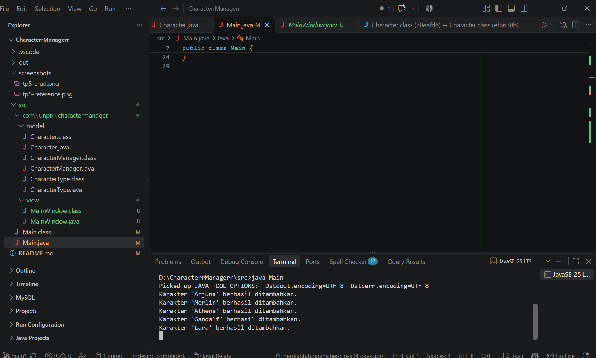
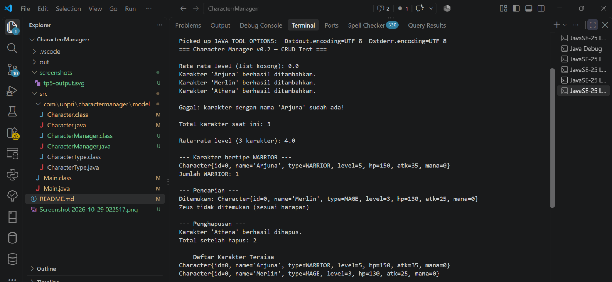
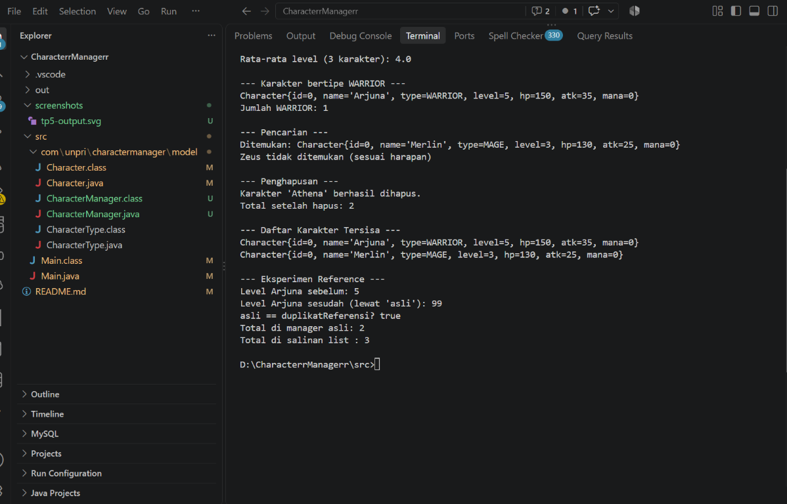

# Character Manager — Java Visual TP8

Aplikasi Java untuk mengelola data karakter dan menampilkannya melalui GUI menggunakan Swing. Pada TP8, program menyiapkan data di `CharacterManager`, lalu menampilkan daftar karakter dan rata-rata level pada jendela `MainWindow`.

## Identitas

- **Nama:** Herdianta Yuventus Tarigan
- **NIM:** 253303621206
- **Kelas:** SI pagi3A
- **Tanggal:** 3 November 2026

## TP8 — GUI dan MVC

### Fitur

- Membuat lima karakter: Arjuna, Merlin, Athena, Gandalf, dan Lara.
- Menampilkan nama, tipe, level, HP, dan attack power setiap karakter pada GUI Swing.
- Menampilkan jumlah karakter dan rata-rata level.
- Menjalankan inisialisasi GUI melalui `SwingUtilities.invokeLater()` pada Event Dispatch Thread (EDT).

### Bukti screenshot

Screenshot yang tersedia menunjukkan VS Code dan log penambahan kelima karakter ketika program dijalankan. Screenshot ini membuktikan proses eksekusi, tetapi tidak menampilkan jendela GUI secara langsung.



### Aliran data

`Main` membuat `CharacterManager`, menambahkan data karakter, lalu mengirim hasil `getAllCharacters()` kepada constructor `MainWindow`. `CharacterManager` mengelola koleksi karakter menggunakan `ArrayList<Character>`. `MainWindow` menerima daftar tersebut dan membuat `JLabel` untuk setiap karakter serta statistik rata-rata level. `Main` menjadi titik awal yang menghubungkan data Model dengan View. Controller terpisah belum dibuat; alur aplikasi saat ini bersifat sederhana dan berfokus pada penampilan data.

`MainWindow` mewarisi `JFrame` (relasi **is-a**) karena merupakan jenis jendela Swing. Sebaliknya, `CharacterManager` menyimpan `ArrayList<Character>` (relasi **has-a**) sebagai koleksi internal.

### Analisis GUI & MVC

[Buka Google Docs — Bagian D: Analisis GUI & MVC](https://docs.google.com/document/d/1imlYQ9Aih3xNyvJu5ATt4Si4RcZcdOnRJO2-pMKvIcI/edit)

Dokumen disetel ke **Siapa saja yang memiliki link — Pelihat (Viewer)**.

## TP5 — CRUD dan object reference

TP5 menambahkan pengelolaan koleksi karakter, termasuk:

- Menambah karakter dan menolak nama duplikat (case-sensitive).
- Mencari serta menghapus karakter berdasarkan nama.
- Menampilkan karakter berdasarkan tipe, jumlah karakter, rata-rata level, dan karakter dengan attack power tertinggi.
- Mengembalikan salinan list melalui `getAllCharacters()` agar pemanggil tidak mengubah koleksi internal secara langsung.





Eksperimen reference menunjukkan bahwa dua variabel dapat menunjuk ke objek `Character` yang sama, sehingga perubahan lewat salah satunya terlihat melalui variabel lain. Sebaliknya, `getAllCharacters()` mengembalikan salinan list; menambahkan elemen ke salinan tidak menambah koleksi internal manager.

## Menjalankan program

Dengan JDK terpasang, jalankan perintah berikut dari direktori repository:

```powershell
javac -encoding UTF-8 -d out src\Main.java src\com\unpri\charactermanager\model\Character.java src\com\unpri\charactermanager\model\CharacterType.java src\com\unpri\charactermanager\model\CharacterManager.java src\com\unpri\charactermanager\view\MainWindow.java
java -cp out Main
```

## Struktur project

```text
.
├── README.md
├── screenshots/
│   ├── tP8.png
│   ├── tp5-crud.png
│   └── tp5-reference.png
└── src/
    ├── Main.java
    └── com/
        └── unpri/
            └── charactermanager/
                ├── model/
                │   ├── Character.java
                │   ├── CharacterManager.java
                │   └── CharacterType.java
                └── view/
                    └── MainWindow.java
```
